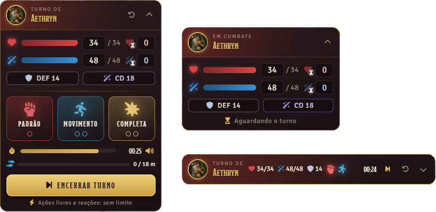
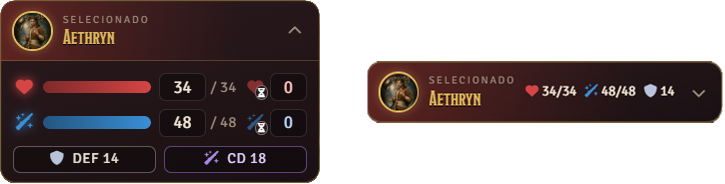
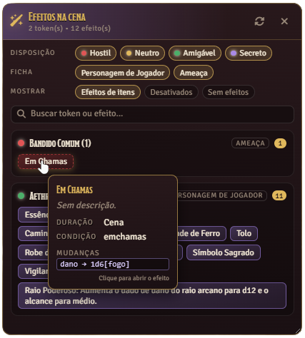

[](https://www.youtube.com/@olhodatormenta)

# ⚔️ T20 — HUD de Ações e Painel de Efeitos

**Mais agilidade nos combates. Mais controle para o Mestre. Uma experiência melhor para todos.**

Um módulo para **Tormenta20 no Foundry Virtual Tabletop v13 e v14** que simplifica o gerenciamento de ações, recursos, deslocamento e turnos dos personagens, além de oferecer ao Mestre um painel centralizado para acompanhar os efeitos ativos da cena.

<p align="center">
  
  
  
</p>

---

## 🖥️ Demonstração

Uma HUD projetada para manter as informações importantes sempre acessíveis, sem precisar abrir constantemente a ficha do personagem.

### ⚔️ Durante o combate

Acompanhe os recursos do personagem, gerencie suas ações, monitore o deslocamento e controle o tempo do turno. Alterne entre a interface completa e a versão compacta conforme sua preferência.

<p align="center">
  
</p>

### 🛡️ Fora do combate

Consulte rapidamente PV, PM, Defesa e CD das magias por meio de uma interface compacta que ocupa menos espaço na tela.

<p align="center">
  
</p>

### 🎭 Painel de Efeitos — Interface do Mestre

O Painel de Efeitos centraliza as condições e os efeitos ativos dos tokens da cena, permitindo ao Mestre consultar informações detalhadas sem precisar abrir individualmente cada ficha ou efeito.

<p align="center">
  
</p>

<p align="center">
  <em>Botão de acesso ao Painel de Efeitos, localizado na lateral esquerda da interface do Foundry VTT.</em>
</p>

<p align="center">
  
</p>

<p align="center">
  <em>Visualização do painel com filtros, efeitos organizados por token e detalhes exibidos ao passar o mouse sobre uma tag.</em>
</p>

**Recursos em destaque:**

- **Filtros rápidos:** organize os efeitos por disposição dos tokens e tipo de ficha.
- **Busca integrada:** encontre tokens ou efeitos pelo nome.
- **Identificação visual:** diferencie condições, efeitos de itens, efeitos temporários e efeitos desativados.
- **Detalhes instantâneos:** consulte duração, origem, condições e alterações aplicadas pelo efeito.
- **Acesso direto:** clique em uma tag para abrir o efeito correspondente.
- **Navegação rápida:** selecione um token e centralize a visualização nele.
- **Atualização automática:** acompanhe as alterações ocorridas durante a sessão.

<p align="center">
  <em>O painel pode ser aberto pelo botão dourado na lateral esquerda ou pelo comando `/efeitos` no chat. Seu acesso é exclusivo do Mestre.</em>
</p>

---

## ✨ Funcionalidades

### 🗡️ HUD do personagem

Uma interface arrastável, recolhível e personalizável que acompanha o token selecionado ou o combatente do turno.

- **PV e PM:** acompanhe os valores atuais, máximos e as respectivas barras.
- **Recursos temporários:** visualize e edite PV e PM temporários.
- **Defesa e CD:** consulte a Defesa total e a CD das magias.
- **Edição rápida:** clique em um valor para alterá-lo diretamente. Digite um número absoluto ou use `+5` e `-5` para ajustar o valor atual. Apagar o campo de PV, PM ou dos temporários volta o valor a 0.
- **Defesa, RD e imunidades:** a Defesa aparece como um **escudo** com o número dentro (ocupa menos espaço), com o campo de bônus logo ao lado. Cada **redução de dano** ganha a sua tag (**RD** geral e uma para cada tipo, como **Fogo 10**) e cada **imunidade a dano** da ficha também. Os valores são lidos de `system.tracos` (`resistencias` e `imunidades`); o que a ficha não expuser não aparece.
- **Bônus de defesa:** ao lado do escudo há um campo para somar um bônus temporário (digite `2`, ou `+1` / `-1` para ajustar). Ele vale só na HUD (não altera a ficha) e é guardado no personagem.
- **Gaveta de dano, cura e mana:** uma aba **Dano** na borda esquerda da HUD abre uma gaveta colada à HUD (mesma altura e mesmo estilo; ela acompanha a HUD quando você a arrasta). Um único campo de **valor** serve para todos os botões: **Causar dano** (com o **tipo** de dano e a opção de ignorar a RD, e uma prévia do dano final), **Curar** (recupera PV até o máximo), **Gastar PM** (usa primeiro os PM temporários e avisa se faltar mana) e **Receber PM** (até o máximo). **Causar dano** (ou `Enter`) desconta a RD (geral + do tipo; se o personagem é **imune** ao tipo, o dano final é 0), tira primeiro dos PV temporários e depois dos PV. Apenas o **Mestre** vê os botões **Zerar vida** (PV e PV temporários a 0) e **Curar tudo** (PV ao máximo), ambos com confirmação.
- **Animação de perda e ganho:** quando PV, PM, PV temporário ou PM temporário diminuem (por dano, gasto de PM ou edição na HUD, não importa a origem), a linha treme, a barra pisca, o ícone "bate", um rastro claro escorre até o novo valor e um número flutuante (por exemplo, **−8**) sobe a partir do campo. Cada recurso tem a sua cor: vermelho para vida e azul para mana, em tom mais claro para os temporários. Com a HUD recolhida, o resumo de PV e PM pisca. Nos ganhos (cura, recuperação de PM, PV/PM temporários) a linha acende em verde (PV) ou ciano (PM), a barra enche com um brilho até o novo valor, o ícone pulsa e um número flutuante (por exemplo, **+8**) sobe a partir do campo. A animação é desligada para quem usa a opção de reduzir movimento do sistema.
- **Modo compacto:** recolha a HUD para manter um resumo dos recursos e das ações disponíveis.
- **Imagem personalizável:** escolha entre a imagem do token e o retrato do personagem.
- **Controle de acesso:** jogadores visualizam os tokens que controlam; o Mestre pode visualizar qualquer token.
- **Visual da HUD:** o botão de ajustes (sliders) no cabeçalho abre um painel com **tema** de cores (Vinho, Cinza, Azul-noite, Floresta, Ametista), **tamanho**, **opacidade**, **desfoque**, **cantos**, **cor principal** (o fundo, a gaveta, os menus e a faixa do topo derivam dela), **cor de destaque** e **faixa do topo**. Cada usuário escolhe o seu, e há botão para restaurar o padrão. O menu de ações, o tooltip das regras, a gaveta de dano e o volume acompanham o tema escolhido.
- **Volume do alerta:** o botão de volume do cabeçalho abre, acima da HUD, um controle horizontal (como o do YouTube) com botão de mudo e barra deslizante; o valor é o volume máximo do alerta de fim de tempo.
- **Limite de tempo no cabeçalho:** o botão do cronômetro (Mestre) fica ao lado de recolher. Com o limite em 0, a HUD mostra só o contador.
- **Gastar movimento do Mestre:** botão de pegadas no cabeçalho (só para o Mestre) liga e desliga o gasto de movimento dos tokens movidos por ele. É uma preferência individual de cada Mestre.
- **Desfazer ação:** cada ação gasta ganha um ícone de desfazer (↺) no canto (Padrão, Movimento e Completa); o botão direito continua funcionando.

### 🎯 Gerenciamento de ações

A HUD acompanha o gasto das ações durante o turno, seguindo os tipos de ação utilizados pelo módulo.

| Tipo de ação | Funcionamento |
| --- | --- |
| Padrão | Consome a ação padrão. |
| Movimento | O primeiro uso consome a ação de movimento; o segundo utiliza a ação padrão para permitir outro movimento. |
| Completa | Consome as ações padrão e de movimento simultaneamente. |
| Livre e reação | Não possuem limite de uso imposto pela HUD. |

**Ação extra (efeito Velocidade):** se o personagem tiver um efeito ativo chamado **"Velocidade"** ou **"Poção de Velocidade"** (inclusive vindo de um item), ele ganha uma ação extra por turno, que vale como **uma ação padrão ou uma ação de movimento**.

- A HUD mostra um cartão **Extra** (e um ícone de raio na versão recolhida).
- A ação extra é gasta sozinha quando a padrão ou o movimento já foram usados, seja pelos botões, por itens ou andando. O gasto aparece no card e no anúncio do chat.
- Andar com a ação extra aumenta o limite de deslocamento em mais um movimento.
- Botão direito em Padrão ou Movimento devolve a ação extra primeiro; o `Ctrl + Z` também a devolve.
- Efeitos desativados ou suprimidos não contam.

Outros recursos:

- Clique com o botão direito em uma ação para devolver o gasto.
- Reinicie todas as ações com o botão de reinicialização.
- As ações são restauradas no início de cada turno pelo Mestre conectado.
- A interface compacta indica visualmente quais ações continuam disponíveis.
- Ao enviar um item para o chat, o módulo pode registrar automaticamente o gasto da ação correspondente.
- Armas consomem ação padrão; poderes, magias e outros itens utilizam o tipo de execução indicado na ficha.
- Cada item é contabilizado uma única vez por turno.
- Opcionalmente, anuncie no chat quando uma ação for gasta.

### 📖 Botões de Ações (regras rápidas)

Quatro categorias **dentro da HUD** (**Padrão**, **Movimento**, **Completa** e **Livre**) para consultar e usar as ações de combate sem abrir o livro.

- **Layout largo (padrão, em combate):** para **todos os combatentes**, no turno ou fora dele, a HUD vira uma só, mais larga, com duas colunas sob um único cabeçalho. À esquerda ficam os recursos, a Defesa e a CD, os cartões de ação, o deslocamento, o timer e o botão de encerrar turno. À direita ficam **as quatro categorias de ações ao mesmo tempo** (Padrão, Movimento, Completa e Livre), uma abaixo da outra, separadas por uma linha. Os botões de recolher e de reiniciar ações ficam no canto direito do cabeçalho.
  - Fora do turno, as ações padrão, de movimento e completas aparecem esmaecidas, e só as ações livres podem ser usadas.
- **Layout compacto:** fora de combate, ou com a opção "Compacto" ligada, a HUD fica estreita e mostra uma linha com os quatro botões. Clicar em um deles abre a lista de ações num menu flutuante, junto ao botão.
- A lista de cada categoria é esta:
  - **Ações Padrão:** Agredir, Lançar uma Magia, Atropelar, Fintar, Preparar e Usar Habilidade ou Item.
  - **Ações de Movimento:** Levantar-se, Manipular Item, Mirar e Sacar ou Guardar Item.
  - **Ações Completas:** Corrida, Golpe de Misericórdia, Investida e Lançar uma Magia.
  - **Ações Livres:** Atrasar, Falar, Jogar-se no Chão e Largar um Item.
- **Passe o mouse** sobre uma ação para ler a regra completa.
- **Clique em uma ação para usá-la:** o módulo **gasta a ação correspondente** na HUD (padrão, movimento ou completa; ações livres não gastam nada) e envia ao chat um **card no mesmo estilo da HUD**, com o nome, a regra, o custo e as ações que restam.
  - No turno do personagem, a ação é gasta. Se já não houver ação disponível, aparece um aviso e o card não é enviado.
  - Em combate, fora do turno, só as ações livres podem ser usadas.
  - Fora de combate, o card é enviado e nada é gasto.
- **Ações marcadas com `auto`** (Agredir, Lançar uma Magia e Usar Habilidade ou Item) já são gastas pelo módulo quando você ataca, lança a magia ou usa o item pela ficha, e andar já gasta a ação de movimento. Nelas, o clique só consulta a regra e envia o card, sem gastar a ação de novo.
- **Corrida:** abre uma janela para **escolher a perícia** do teste (a **padrão**, Atletismo, já vem marcada), gasta a ação completa e rola a perícia **pela própria ficha**, com o diálogo e os efeitos de uso do sistema. Ao resultado soma-se +/–2 para cada 1,5 m de deslocamento acima ou abaixo de 9 m, e o personagem avança tantos quadrados de 1,5 m quanto o total. O card mostra a conta e a distância, e a barra de deslocamento da HUD passa a usar esse limite. Cancelar a janela (ou o diálogo da ficha) não gasta nada.
  - Só se corre **em linha reta** (sem curvas nem voltas) e **sem terreno difícil**; movimentos fora disso são bloqueados com um aviso.
  - **Fôlego:** o personagem aguenta **1 + Constituição** rodadas seguidas de corrida. Depois disso, cada nova rodada pede um teste de **Fortitude** (CD 15, +1 por teste anterior). O teste de Fortitude também abre a janela de perícia (com Fortitude marcada) e é rolado pela ficha. Se falhar, recebe **Fatigado**; uma nova falha estando fatigado aplica **Exausto**.
  - As rolagens usam `actor.rollPericia(chave)` do sistema. O bônus mostrado na janela é lido de `system.pericias`.
- **Atrasar:** só no próprio turno, em combate. Abre uma janela para escolher **depois de quem** o personagem vai agir (a Iniciativa vira a do escolhido menos 0,01) ou para digitar uma **Iniciativa específica** (menor que a atual e até o limite de –10 menos o bônus de Iniciativa). A nova Iniciativa vale pelo resto do combate, o card informa a mudança e o turno passa para quem vinha depois. Se o personagem não é o Mestre, o pedido é executado pelo Mestre conectado. O novo valor não pode ser fixado "em tempo real" no turno de outra criatura; escolha o valor ou a criatura de antemão.
- **Fintar:** usa o **alvo marcado** (tecla `T`) quando há exatamente um; senão abre uma janela com as criaturas em **alcance curto** (9 m) para escolher, com a distância de cada uma. O Mestre pode listar todos os tokens da cena ou **arrastar para a janela qualquer ator da lista de Atores (ou de um compêndio), mesmo que não esteja em cena** (a janela deixa a barra lateral clicável para isso; em atores de compêndio a condição não pode ser aplicada e o card avisa), e o jogador pode **deixar o Mestre escolher** quem faz o teste. Depois, abre a janela de perícia (**Enganação** marcada como padrão) e rola pela ficha. O alvo faz o teste de **Reflexos** (também com a janela de perícia e a rolagem da ficha; se o alvo é do Mestre, o teste é feito no computador do Mestre). Vence o maior total; em empate, o maior bônus; persistindo, o card avisa o empate. Se passar, o alvo recebe **Desprevenido**, removido automaticamente no fim do **próximo turno** de quem fintou (ou ao fim do combate). Cancelar qualquer etapa antes da rolagem não gasta a ação; se o teste for cancelado depois, a ação padrão é devolvida.
- **Largar um Item:** abre uma janela (no verde da ação livre) com os itens da ficha (armas, equipamentos, consumíveis, tesouros e ferramentas) e, para pilhas, a quantidade a largar. Usa o **Item Piles** para criar o token do item na casa do personagem, por baixo do token dele (se já houver uma pilha ali, o item entra nela), e tira o item da ficha. Sem o Item Piles ativo, o módulo avisa e não faz nada.
- **Condição Caído:** **Jogar-se no Chão** aplica a condição Caído ao personagem, e **Levantar-se** a remove. Se o personagem já estiver caído, Jogar-se no Chão avisa e não faz nada. Se não estiver caído, Levantar-se avisa e não gasta a ação de movimento.
- **Investida:** gasta a ação completa e libera o deslocamento de até **o dobro do seu deslocamento (mínimo 3 m)**, só **em linha reta** e **sem terreno difícil** (a barra de deslocamento usa esse limite). O card lembra **+2 no ataque** (aplique ao rolar o ataque pela ficha) e **Atropelar como ação livre**. O **−2 na Defesa** entra automaticamente no bônus de defesa da HUD e é desfeito no início do próximo turno do personagem (ou ao fim do combate).
- **Golpe de Misericórdia:** ao clicar, abre uma janela no estilo da HUD para escolher uma **arma corpo a corpo equipada**. Sem arma corpo a corpo equipada, a ação não é permitida e nada é gasto. Escolhida a arma, o módulo gasta a ação completa e envia ao chat um card com:
  - o ataque, que é sempre um **20 natural automático** (acerto crítico), com o multiplicador de crítico da arma;
  - uma rolagem de **1d4** para a morte instantânea, com o resultado para **personagens e NPCs importantes** (25%: morre com 1) e para **NPCs secundários** (75%: morre com 1 a 3), cada um marcado como MORRE ou SOBREVIVE;
  - o nome do alvo, se houver um token marcado como alvo.

  O dano do acerto crítico não é rolado automaticamente: o card avisa para rolar o dano da arma pela ficha.
- O menu fecha ao clicar fora, ao apertar Esc ou quando a HUD é recolhida.
- Os textos ficam no arquivo `scripts/acoes-t20.js`, onde você pode ajustar uma regra ou incluir outra ação.

### 💬 Estilo do módulo no chat

Opção do **mundo** (**Estilo do módulo no chat**, ligada por padrão) que aplica o visual da HUD às mensagens do chat. O Mestre liga e desliga para todos; cada jogador pode desmarcar **Ver o estilo do módulo no meu chat** para ver o chat original só para si. É só CSS e pequenos ajustes de HTML (`styles/chat-estilo.css`): todas as informações e botões das mensagens continuam, só muda o estilo.

- **Cores e cartões neutros:** fundo cinza bem escuro em todos os cards (sem fundos avermelhados), legível também no tema claro do Foundry. As cores de destaque seguem a **cor do jogador dono da ficha** (sem dono jogador, a de quem rolou).
- **Card único de item, ataque, magia e poder:** o cabeçalho da mensagem vira a faixa de identificação (retrato que abre a ficha + nome); título, descrição, fichas (Execução, Alcance, Duração, Resistência), melhorias, rolagens e rodapé ficam numa só peça. **Ataque e Dano ficam lado a lado, com a mesma altura.** Tags como `[corte]` e custos de 0 PM não aparecem; o título do dano é "Dano", "Cura" ou "Recuperação de mana".
- **Rolagens:** fórmula discreta, total grande, dados com o formato de cada tipo (d4 triângulo, d6 quadrado arredondado, d8 losango, d10 losango alongado, d12 pentágono, d20 hexágono), maior valor em verde, menor em vermelho e rerrolado riscado. Grupos de dados do mesmo tipo de dano são unidos; vários tipos viram células lado a lado. Rolagens avulsas (`/r`, perícias, testes) recebem o mesmo acabamento.
- **Resultado do ataque:** só o símbolo (✓ verde, ✗ vermelho, estrela dourada no crítico) ao lado do total; alvo e Defesa ficam na dica.
- **Falha crítica:** qualquer d20 que tire 1 ganha a moldura vermelha quebrada.
- **Botões:** aplicar dano (dano, dobro, metade, cura), gasto de PM, aplicar condição, "Colocar Área de Efeito" e os de rolagem têm o mesmo estilo dos atalhos de condição e ficam sempre visíveis. Rolagens em linha (`[[1d6]]`) viram botões que combinam com o card.
- **Rolagens em linha com tipo de dano:** em textos como "sofre 1d6 de dano de fogo", o tipo é lido do texto e associado à rolagem; Em Chamas vira fogo e Sangrando vira perda de vida.
- **Cards únicos de condições e ações:** condições (cor por tipo), Teste de Morte, Em Chamas, Fintar e os cards dos botões de Ações têm fundo cinza escuro com a cor do tipo de ação.
- **Marcador de rodada:** uma faixa fina com o losango, sem ocupar espaço vertical.
- **Mensagens digitadas e privadas:** texto com o visual do módulo; sussurros e rolagens cegas mantêm as indicações do Foundry e do `t20-hayd-ui`.
- **Mensagens de outros módulos:** o botão direito em mensagens compactas (como as do Tiny Monitor) abre um menu para **copiar** ou **excluir**.

### 🎨 Cor da ficha no chat
- Configurações > **Usar a cor da ficha no chat** (Mestre, ligado por padrão). Com ela ligada, as mensagens usam a cor configurada na ficha do **t20-hayd-ui** (botão **Cor da Ficha**: vale a **cor no chat** da ficha; sem ela, a cor da ficha), em vez da cor do jogador. Assim um jogador com várias fichas é diferenciado pela cor.
- Sem cor no Hayd UI, usa a cor do anel do token; sem anel, a cor do jogador.

### 🔥 Animações do dano e da cura

Quando todo o dano de uma rolagem é de um único tipo, uma animação em pixel art roda atrás do valor (o número continua legível). Há efeitos para fogo, ácido, eletricidade, essência, frio, luz, psíquico, trevas, corte, perfuração, impacto, cura de PV, recuperação de mana e perda de vida.

- **Desativadas por padrão:** nenhum efeito roda até o usuário ativá-lo.
- **Escolher efeitos:** Configurações > Animações do dano e da cura > **Escolher animações**. A janela mostra uma grade com a prévia de cada efeito; ative um por um ou use **Ativar todos** / **Desativar todos**. Cada usuário escolhe os seus.
- **Versões alternativas:** cada efeito tem uma versão **Original** e versões alternativas; escolha pela lista de cada carta, com prévia ao vivo.
- **Todos os tipos do card:** a opção **Animar todos os tipos de dano do card** (desligada por padrão) mostra, em rolagens com tipos misturados, o efeito de cada tipo lado a lado.
- **Animação por item:** na ficha do item, o botão **Animação** (ícone de fogo) escolhe o efeito do dano daquele item: **Automática** (pelo tipo do dano), **Nenhuma** ou um efeito específico com a versão desejada. Por exemplo, um arco pode sempre animar com fogo. Só vale se o efeito estiver ativo nas configurações.

### 🤝 Compatibilidade com outros módulos de chat

O módulo foi preparado para conviver com módulos que também alteram o chat, mantendo o visual do módulo e os recursos de cada um:

| Módulo | Integração |
| --- | --- |
| **t20-hayd-ui** | Descrição recolhível pelo clique no nome, resumo "Encantos e melhorias" com popover, listas de Aprimoramentos e Outros bônus, "Mostrar mais" e o selo de privacidade continuam funcionando, com o visual do módulo. O avatar duplicado é escondido; no estilo "novo" dele, os blocos de rolagem são desfeitos para o layout do módulo. |
| **t20-hayd-gmtools** | Barras de ação nos cards (resistência, manobra, engenhocas, venenos, contadores), auras, mensagens de dano/cura/mana, prévia de dano e pedidos de rolagem, com o visual do módulo. |
| **t20-hayd-loja** | Cards de compra, venda, saldo, estoque, construção e aprimoramento viram cards únicos no estilo dos cards de ação (moedas, melhorias e o botão de trocar sucesso/falha incluídos). |
| **t20-hayd-itens** | Nota de munição, selos de encantos/materiais, botões do rodapé dos cards de arma (injeção, Conjuradora, Sanguinária etc.), aviso de disparo sem munição e os cards próprios do módulo (Dançarina, injeção alquímica) continuam funcionando; os cards próprios viram cards únicos no estilo do módulo. |
| **t20-hayd-bases-e-dominios** | Cards de bases, negócios e domínios viram cards únicos no estilo dos cards de ação (na cor do domínio), com o botão de alterar sucesso/falha da obra e os demais botões no estilo do módulo. |
| **t20a-chat** | As variáveis e classes dele são redefinidas pelo visual do módulo. |
| **Item Piles** | Cards de compra e venda no estilo do módulo; as mensagens do Item Piles que montam o próprio cabeçalho ficam como estão. É também o que cria o token da ação **Largar um Item**. |
| **Munição e melhorias** (`hayd-municao`, `hbdg`), resultado contra a Defesa, aviso de camuflagem e dano maximizado | Reestilizados e agrupados logo abaixo do título do card de item. Nenhum elemento é removido. |

Os ajustes do módulo no chat são registrados depois dos de todos os outros módulos, para sempre enxergarem o HTML já alterado por eles.

**Bandeirinha de privacidade:** o selo do t20-hayd-ui para rolagens privadas, cegas, particulares e sussurros vira uma bandeirinha no topo do card, entre o nome e a hora/lixeira: só o símbolo fica à vista e o texto aparece ao passar o mouse.

**Condições com pop-up** (opção pessoal, ligada por padrão): nas descrições de poderes, magias e itens no chat, o nome de cada condição (ofuscado, atordoado, lento, em chamas…) ganha um destaque pontilhado; ao passar o mouse abre um pop-up temporário com a descrição, sem abrir o diário de condições. O texto vem dos efeitos de status do sistema e, se não houver, dos diários e compêndios de "Condições".

### ⏱️ Temporizador de turno

Mantenha o combate fluido com um contador configurável para cada turno.

- Contagem regressiva acompanhada por uma barra de progresso.
- Alerta visual nos últimos 10 segundos.
- Animação e som quando o tempo termina.
- Escolha de arquivo de áudio personalizado ou utilização do som padrão do módulo.
- Controle de volume e teste do som.
- Configuração de quem ouve o alerta.
- Opção para passar o turno automaticamente ao final da contagem.
- Possibilidade de definir o tempo máximo como zero, desativando o limite.

### 🏃 Controle de deslocamento

Acompanhe a movimentação dos tokens durante o combate, com limites baseados nas regras configuradas.

- Utiliza o deslocamento da ficha, com padrão de 9 metros.
- Permite ultrapassar o deslocamento normal utilizando uma segunda ação de movimento.
- Bloqueia movimentações que ultrapassem o limite permitido.
- Exibe uma barra com a distância utilizada e o limite disponível.
- Utiliza o custo de movimento calculado pelo Foundry, incluindo terreno difícil e diagonais.
- Considera arrastos divididos em vários trechos como uma única movimentação, quando aplicável.
- Permite desfazer movimentações com `Ctrl + Z`, recuperando a distância e a ação gastas.
- Ao devolver uma ação de movimento, o token retorna pelo caminho percorrido até o ponto correspondente.
- Pode restringir a movimentação dos jogadores ao próprio turno, mantendo a liberdade do Mestre.

### 🎭 Painel de Efeitos

Uma ferramenta exclusiva do Mestre que centraliza os efeitos dos tokens presentes na cena.

- **Organização por token:** visualize os efeitos agrupados por personagem ou criatura.
- **Identificação visual:** condições em vermelho, efeitos de itens em azul, efeitos temporários com borda tracejada e efeitos desativados com aparência apagada e riscada.
- **Detalhes rápidos:** passe o mouse sobre uma tag para consultar descrição, duração, tempo restante, origem, condição, estado e as primeiras alterações aplicadas pelo efeito.
- **Acesso direto:** clique em uma tag para abrir o efeito correspondente.
- **Navegação pela cena:** clique no nome de um token para selecioná-lo e centralizar a visualização.
- **Filtros:** organize os resultados por disposição, tipo de ficha, origem e estado dos efeitos.
- **Pesquisa:** encontre tokens ou efeitos pelo nome.
- **Atualização automática:** acompanhe mudanças nos efeitos, tokens, itens e combate.
- **Interface ajustável:** mova e redimensione a janela conforme sua preferência.
- **Filtros persistentes:** mantenha suas preferências entre sessões.

**Como abrir:** clique no botão dourado na lateral esquerda da interface do Foundry ou digite `/efeitos` no chat.

---

## 📦 Instalação

No Foundry: Add-on Modules > Install Module e cole em Manifest URL:

https://github.com/dralfin/T20-HUD-de-Acoes-e-Painel-de-Efeitos/releases/latest/download/module.json

Depois ative o módulo no mundo.

### Requisitos

- **Foundry Virtual Tabletop:** versões 13 e 14.
- **Sistema de jogo:** Tormenta20.
- **Opcionais:** Item Piles (ação Largar um Item); t20-hayd-ui, t20-hayd-gmtools, t20-hayd-loja, t20-hayd-itens e t20-hayd-bases-e-dominios (integração no chat).

---

## ⚙️ Configurações

O módulo oferece configurações globais para o mundo e opções individuais para cada usuário.

### Configurações do mundo

Disponíveis para o Mestre:

- Limitar o movimento dos tokens em combate.
- Bloquear movimentação fora do turno.
- Definir o deslocamento padrão em metros.
- Configurar os metros por quadrado, com padrão de 1,5 m.
- Ativar o gasto automático de ações ao utilizar itens.
- Anunciar o gasto de ações no chat.
- Enviar o card da ação ao chat ao usar os botões de Ações.
- Definir o tempo máximo por turno.
- Configurar o som de tempo esgotado e quem pode ouvi-lo.
- Passar o turno automaticamente ao final do temporizador.
- Ativar ou desativar o Painel de Efeitos.
- Ligar ou desligar o **estilo do módulo no chat** para todos.

### Configurações pessoais

Disponíveis individualmente:

- Mostrar ou ocultar a HUD para o Mestre.
- Mostrar ou ocultar os botões de Ações (regras rápidas).
- Escolher o layout da HUD em combate (largo, com painel de ações ao lado, ou compacto).
- Escolher entre a imagem do token e o retrato do personagem.
- Personalizar o **visual da HUD** (tema, cores, opacidade, desfoque, cantos).
- Escolher as **animações do dano e da cura** (efeitos e versões) e se animam todos os tipos do card.
- **Gastar movimento também do Mestre** (só Mestre).
- **Ver o estilo do módulo no meu chat**.
- Ajustar o tamanho da HUD.
- Configurar o volume dos sons.
- Ativar o modo de teste que aplica ao Mestre as mesmas restrições de um jogador.
- Habilitar a depuração no console.

---

## 🧩 API para macros

O módulo disponibiliza uma API que pode ser utilizada por macros do Foundry VTT.

```javascript
const api = game.modules.get("t20-acoes-hud")?.api;
```

### Métodos disponíveis

| Método | Descrição |
| --- | --- |
| `gastarPorItem(item)` | Registra o gasto da ação de um item, como se ele tivesse sido enviado ao chat. |
| `tipoDeAcao(item)` | Retorna `"padrao"`, `"movimento"`, `"completa"` ou `null`. |
| `painelEfeitos.abrir()` | Abre o Painel de Efeitos. |
| `painelEfeitos.fechar()` | Fecha o Painel de Efeitos. |
| `painelEfeitos.alternar()` | Alterna entre abrir e fechar o painel. |

Os métodos do Painel de Efeitos são destinados ao Mestre.

---

## 🔄 Compatibilidade com o Foundry

- **Foundry v13 e v14:** o módulo foi atualizado para funcionar nas duas versões.
- **Efeitos no v14:** o Foundry v14 alterou o formato dos efeitos ativos. O Painel de Efeitos lê os formatos compatíveis, incluindo duração e evento de expiração, quando disponibilizados pelo sistema.
- **Movimentação:** as regras utilizam os recursos de movimento de token disponíveis na versão do Foundry. Se um recurso não existir, o módulo utiliza uma alternativa.
- **Comando `/efeitos`:** depende do evento de chat do Foundry. Se não funcionar, abra o painel pelo botão dourado na lateral esquerda.

---

## ⚠️ Limitações conhecidas

- A edição direta de PV e PM modifica os valores da ficha sem executar o cálculo de dano do sistema. Já o menu de dano da HUD aplica a redução de dano da ficha e as imunidades a tipos de dano, mas não considera vulnerabilidades.
- **Largar um Item** depende do módulo Item Piles e da configuração de quantidade dele para o sistema Tormenta20.
- Os recursos de integração com outros módulos foram feitos a partir do HTML que eles geram hoje; uma atualização que mude esse HTML pode exigir ajustes.
- O controle de deslocamento não considera condições que alteram a velocidade nem outros tipos de deslocamento, como voo e natação.
- O temporizador não pausa quando o jogo está pausado.
- A integração depende de campos específicos da ficha do Tormenta20, incluindo recursos, Defesa, atributo de conjuração e execução dos itens.
- Magias cuja execução não pode ser identificada são tratadas como ações padrão.
- Se algum valor não aparecer ou estiver incorreto, ative a depuração e verifique as mensagens do módulo no console do navegador (`F12`).

---

## 🔧 Solução de problemas

<details>
<summary><strong>A HUD não aparece</strong></summary>

Selecione um token que você controla. Se estiver conectado como Mestre, confira se a opção **Mostrar a HUD para o Mestre** está ativada.

</details>

<details>
<summary><strong>O Painel de Efeitos não abre</strong></summary>

Verifique se você está conectado como Mestre e se a configuração **Ativar o Painel de Efeitos (Mestre)** está habilitada. Também é possível abrir o painel digitando `/efeitos` no chat.

</details>

<details>
<summary><strong>Um token não consegue se mover</strong></summary>

Ative a opção de depuração no console, tente mover o token e procure as mensagens `preMoveToken`. Elas ajudam a identificar se o módulo bloqueou a movimentação e por qual motivo.

Verifique também se o jogador está no próprio turno, se o limite de deslocamento foi atingido e se as restrições estão habilitadas. O Mestre só fica sujeito às mesmas limitações quando o modo de teste está ativado.

</details>

<details>
<summary><strong>Os valores de PV, PM ou CD estão incorretos</strong></summary>

Ative a depuração no console (`F12`) e verifique os campos utilizados pelo módulo na ficha do Tormenta20. O funcionamento depende dos dados disponibilizados pelo sistema.

</details>

---

## 🤝 Contribuições e sugestões

Encontrou um problema, identificou um comportamento inesperado ou tem uma ideia para melhorar o módulo?

Abra uma [issue no GitHub](https://github.com/dralfin/T20-HUD-de-Acoes-e-Painel-de-Efeitos/issues) para relatar erros e sugerir funcionalidades.

Contribuições e feedbacks são bem-vindos!

---

<p align="center">
  <strong>Desenvolvido para tornar os combates de Tormenta20 no Foundry VTT mais fluidos, organizados e dinâmicos.</strong>
</p>

<p align="center">
  <strong>Desenvolvido por Olho da Tormenta</strong>
</p>

### 📜 Nik's Tiny Changelogs
- O Tiny Changelogs não reconhece o Tormenta20. Ao entrar como Mestre, o módulo configura sozinho o rastreio de **PV**, **PV temporário** e **PM** (só se o campo de PV ainda estiver vazio), para as mudanças feitas na ficha aparecerem no chat.
