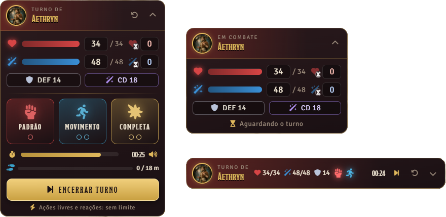
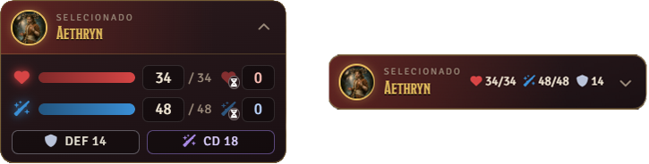
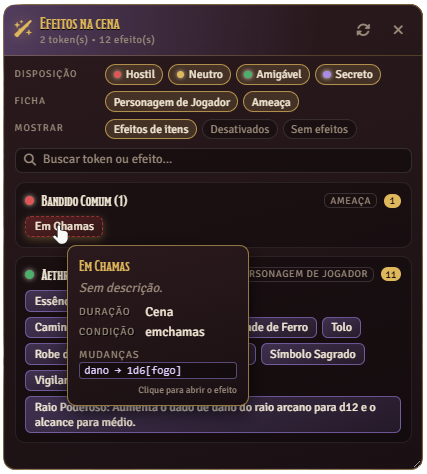

# ⚔️ T20 — HUD de Ações e Painel de Efeitos

**Mais agilidade nos combates. Mais controle para o Mestre. Uma experiência melhor para todos.**

Um módulo para **Tormenta20 no Foundry Virtual Tabletop v13** que simplifica o gerenciamento de ações, recursos, deslocamento e turnos dos personagens, além de oferecer ao Mestre um painel centralizado para acompanhar os efeitos ativos da cena.

<p align="center">
  
  
  
</p>

---

## 🖥️ Demonstração

Uma HUD projetada para manter as informações importantes sempre acessíveis, sem precisar abrir constantemente a ficha do personagem.

### ⚔️ Durante o combate

Acompanhe os recursos do personagem, gerencie suas ações, monitore o deslocamento e controle o tempo do turno. Alterne entre a interface completa e a versão compacta conforme sua preferência.

<p align="center">
  
</p>

### 🛡️ Fora do combate

Consulte rapidamente PV, PM, Defesa e CD das magias por meio de uma interface compacta que ocupa menos espaço na tela.

<p align="center">
  
</p>

### 🎭 Painel de Efeitos — Interface do Mestre

O Painel de Efeitos centraliza as condições e os efeitos ativos dos tokens da cena, permitindo ao Mestre consultar informações detalhadas sem precisar abrir individualmente cada ficha ou efeito.

<p align="center">
  
</p>

<p align="center">
  <em>Botão de acesso ao Painel de Efeitos, localizado na lateral esquerda da interface do Foundry VTT.</em>
</p>

<p align="center">
  
</p>

<p align="center">
  <em>Visualização do painel com filtros, efeitos organizados por token e detalhes exibidos ao passar o mouse sobre uma tag.</em>
</p>

**Recursos em destaque:**

- **Filtros rápidos:** organize os efeitos por disposição dos tokens e tipo de ficha.
- **Busca integrada:** encontre tokens ou efeitos pelo nome.
- **Identificação visual:** diferencie condições, efeitos de itens, efeitos temporários e efeitos desativados.
- **Detalhes instantâneos:** consulte duração, origem, condições e alterações aplicadas pelo efeito.
- **Acesso direto:** clique em uma tag para abrir o efeito correspondente.
- **Navegação rápida:** selecione um token e centralize a visualização nele.
- **Atualização automática:** acompanhe as alterações ocorridas durante a sessão.

<p align="center">
  <em>O painel pode ser aberto pelo botão dourado na lateral esquerda ou pelo comando `/efeitos` no chat. Seu acesso é exclusivo do Mestre.</em>
</p>

---

## ✨ Funcionalidades

### 🗡️ HUD do personagem

Uma interface arrastável, recolhível e personalizável que acompanha o token selecionado ou o combatente do turno.

- **PV e PM:** acompanhe os valores atuais, máximos e as respectivas barras.
- **Recursos temporários:** visualize e edite PV e PM temporários.
- **Defesa e CD:** consulte a Defesa total e a CD das magias.
- **Edição rápida:** clique em um valor para alterá-lo diretamente. Digite um número absoluto ou use `+5` e `-5` para ajustar o valor atual.
- **Modo compacto:** recolha a HUD para manter um resumo dos recursos e das ações disponíveis.
- **Imagem personalizável:** escolha entre a imagem do token e o retrato do personagem.
- **Controle de acesso:** jogadores visualizam os tokens que controlam; o Mestre pode visualizar qualquer token.

### 🎯 Gerenciamento de ações

A HUD acompanha o gasto das ações durante o turno, seguindo os tipos de ação utilizados pelo módulo.

| Tipo de ação | Funcionamento |
| --- | --- |
| Padrão | Consome a ação padrão. |
| Movimento | O primeiro uso consome a ação de movimento; o segundo utiliza a ação padrão para permitir outro movimento. |
| Completa | Consome as ações padrão e de movimento simultaneamente. |
| Livre e reação | Não possuem limite de uso imposto pela HUD. |

Outros recursos:

- Clique com o botão direito em uma ação para devolver o gasto.
- Reinicie todas as ações com o botão de reinicialização.
- As ações são restauradas no início de cada turno pelo Mestre conectado.
- A interface compacta indica visualmente quais ações continuam disponíveis.
- Ao enviar um item para o chat, o módulo pode registrar automaticamente o gasto da ação correspondente.
- Armas consomem ação padrão; poderes, magias e outros itens utilizam o tipo de execução indicado na ficha.
- Cada item é contabilizado uma única vez por turno.
- Opcionalmente, anuncie no chat quando uma ação for gasta.

### ⏱️ Temporizador de turno

Mantenha o combate fluido com um contador configurável para cada turno.

- Contagem regressiva acompanhada por uma barra de progresso.
- Alerta visual nos últimos 10 segundos.
- Animação e som quando o tempo termina.
- Escolha de arquivo de áudio personalizado ou utilização do som padrão do módulo.
- Controle de volume e teste do som.
- Configuração de quem ouve o alerta.
- Opção para passar o turno automaticamente ao final da contagem.
- Possibilidade de definir o tempo máximo como zero, desativando o limite.

### 🏃 Controle de deslocamento

Acompanhe a movimentação dos tokens durante o combate, com limites baseados nas regras configuradas.

- Utiliza o deslocamento da ficha, com padrão de 9 metros.
- Permite ultrapassar o deslocamento normal utilizando uma segunda ação de movimento.
- Bloqueia movimentações que ultrapassem o limite permitido.
- Exibe uma barra com a distância utilizada e o limite disponível.
- Utiliza o custo de movimento calculado pelo Foundry, incluindo terreno difícil e diagonais.
- Considera arrastos divididos em vários trechos como uma única movimentação, quando aplicável.
- Permite desfazer movimentações com `Ctrl + Z`, recuperando a distância e a ação gastas.
- Ao devolver uma ação de movimento, o token retorna pelo caminho percorrido até o ponto correspondente.
- Pode restringir a movimentação dos jogadores ao próprio turno, mantendo a liberdade do Mestre.

### 🎭 Painel de Efeitos

Uma ferramenta exclusiva do Mestre que centraliza os efeitos dos tokens presentes na cena.

- **Organização por token:** visualize os efeitos agrupados por personagem ou criatura.
- **Identificação visual:** condições em vermelho, efeitos de itens em azul, efeitos temporários com borda tracejada e efeitos desativados com aparência apagada e riscada.
- **Detalhes rápidos:** passe o mouse sobre uma tag para consultar descrição, duração, tempo restante, origem, condição, estado e as primeiras alterações aplicadas pelo efeito.
- **Acesso direto:** clique em uma tag para abrir o efeito correspondente.
- **Navegação pela cena:** clique no nome de um token para selecioná-lo e centralizar a visualização.
- **Filtros:** organize os resultados por disposição, tipo de ficha, origem e estado dos efeitos.
- **Pesquisa:** encontre tokens ou efeitos pelo nome.
- **Atualização automática:** acompanhe mudanças nos efeitos, tokens, itens e combate.
- **Interface ajustável:** mova e redimensione a janela conforme sua preferência.
- **Filtros persistentes:** mantenha suas preferências entre sessões.

**Como abrir:** clique no botão dourado na lateral esquerda da interface do Foundry ou digite `/efeitos` no chat.

---

## 📦 Instalação

No Foundry: Add-on Modules > Install Module e cole em Manifest URL:

https://github.com/dralfin/T20-HUD-de-Acoes-e-Painel-de-Efeitos/releases/latest/download/module.json

Depois ative o módulo no mundo.

### Requisitos

- **Foundry Virtual Tabletop:** versão 13.
- **Sistema de jogo:** Tormenta20.

---

## ⚙️ Configurações

O módulo oferece configurações globais para o mundo e opções individuais para cada usuário.

### Configurações do mundo

Disponíveis para o Mestre:

- Limitar o movimento dos tokens em combate.
- Bloquear movimentação fora do turno.
- Definir o deslocamento padrão em metros.
- Configurar os metros por quadrado, com padrão de 1,5 m.
- Ativar o gasto automático de ações ao utilizar itens.
- Anunciar o gasto de ações no chat.
- Definir o tempo máximo por turno.
- Configurar o som de tempo esgotado e quem pode ouvi-lo.
- Passar o turno automaticamente ao final do temporizador.
- Ativar ou desativar o Painel de Efeitos.

### Configurações pessoais

Disponíveis individualmente:

- Mostrar ou ocultar a HUD para o Mestre.
- Escolher entre a imagem do token e o retrato do personagem.
- Ajustar o tamanho da HUD.
- Configurar o volume dos sons.
- Ativar o modo de teste que aplica ao Mestre as mesmas restrições de um jogador.
- Habilitar a depuração no console.

---

## 🧩 API para macros

O módulo disponibiliza uma API que pode ser utilizada por macros do Foundry VTT.

```javascript
const api = game.modules.get("t20-acoes-hud")?.api;
```

### Métodos disponíveis

| Método | Descrição |
| --- | --- |
| `gastarPorItem(item)` | Registra o gasto da ação de um item, como se ele tivesse sido enviado ao chat. |
| `tipoDeAcao(item)` | Retorna `"padrao"`, `"movimento"`, `"completa"` ou `null`. |
| `painelEfeitos.abrir()` | Abre o Painel de Efeitos. |
| `painelEfeitos.fechar()` | Fecha o Painel de Efeitos. |
| `painelEfeitos.alternar()` | Alterna entre abrir e fechar o painel. |

Os métodos do Painel de Efeitos são destinados ao Mestre.

---

## ⚠️ Limitações conhecidas

- A edição direta de PV e PM modifica os valores da ficha sem executar o cálculo de dano do sistema. Portanto, redução de dano e imunidades não são aplicadas.
- O controle de deslocamento não considera condições que alteram a velocidade nem outros tipos de deslocamento, como voo e natação.
- O temporizador não pausa quando o jogo está pausado.
- A integração depende de campos específicos da ficha do Tormenta20, incluindo recursos, Defesa, atributo de conjuração e execução dos itens.
- Magias cuja execução não pode ser identificada são tratadas como ações padrão.
- Se algum valor não aparecer ou estiver incorreto, ative a depuração e verifique as mensagens do módulo no console do navegador (`F12`).

---

## 🔧 Solução de problemas

<details>
<summary><strong>A HUD não aparece</strong></summary>

Selecione um token que você controla. Se estiver conectado como Mestre, confira se a opção **Mostrar a HUD para o Mestre** está ativada.

</details>

<details>
<summary><strong>O Painel de Efeitos não abre</strong></summary>

Verifique se você está conectado como Mestre e se a configuração **Ativar o Painel de Efeitos (Mestre)** está habilitada. Também é possível abrir o painel digitando `/efeitos` no chat.

</details>

<details>
<summary><strong>Um token não consegue se mover</strong></summary>

Ative a opção de depuração no console, tente mover o token e procure as mensagens `preMoveToken`. Elas ajudam a identificar se o módulo bloqueou a movimentação e por qual motivo.

Verifique também se o jogador está no próprio turno, se o limite de deslocamento foi atingido e se as restrições estão habilitadas. O Mestre só fica sujeito às mesmas limitações quando o modo de teste está ativado.

</details>

<details>
<summary><strong>Os valores de PV, PM ou CD estão incorretos</strong></summary>

Ative a depuração no console (`F12`) e verifique os campos utilizados pelo módulo na ficha do Tormenta20. O funcionamento depende dos dados disponibilizados pelo sistema.

</details>

---

## 🤝 Contribuições e sugestões

Encontrou um problema, identificou um comportamento inesperado ou tem uma ideia para melhorar o módulo?

Abra uma [issue no GitHub](https://github.com/dralfin/T20-HUD-de-Acoes-e-Painel-de-Efeitos/issues) para relatar erros e sugerir funcionalidades.

Contribuições e feedbacks são bem-vindos!

---

<p align="center">
  <strong>Desenvolvido para tornar os combates de Tormenta20 no Foundry VTT mais fluidos, organizados e dinâmicos.</strong>
</p>

<p align="center">
  <strong>Desenvolvido por Olho da Tormenta</strong>
</p>
